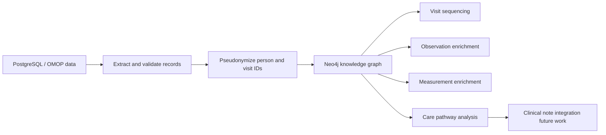

# FarajaMH OMOP Knowledge Graph

A longitudinal mental health knowledge graph that transforms OMOP-derived study data into a clinically meaningful patient journey in Neo4j.

---

## Executive summary

This project develops a longitudinal, person-centered knowledge graph for mental health data derived from OMOP-compliant study records. By linking the same patient across multiple visits and time points, the graph preserves continuity of care and connects observations, measurements, and conditions into a single clinical trajectory. The approach makes it possible to identify how symptoms, scores, and engagement change over time, and to detect where patients are lost to follow-up or disengage from services.

Unlike traditional relational data stores, which primarily represent records as isolated rows, this graph makes patient pathways visible as connected events. This is particularly important for mental health research and service delivery, where trajectories of wellbeing, functioning, and engagement evolve over time and are shaped by both clinical and social factors. The project therefore provides a more clinically interpretable and actionable model for understanding longitudinal care in mental health settings.

---

## Project abstract

This project develops a longitudinal, person-centered knowledge graph for mental health data derived from OMOP-compliant study records. By linking the same patient across multiple visits and time points, the graph preserves continuity of care and connects observations, measurements, and conditions into a single clinical trajectory. The approach makes it possible to identify how symptoms, scores, and engagement change over time and to detect where patients are lost to follow-up or disengage from services.

Unlike traditional relational databases, which primarily represent records as isolated rows, this graph makes patient pathways visible as connected events. This is particularly important for mental health research and service delivery, where trajectories of wellbeing, functioning, and engagement evolve over time and are shaped by clinical and social factors. The project therefore provides a more clinically interpretable and actionable model for understanding longitudinal care in mental health settings.

---

## Project summary

This project builds a longitudinal mental health knowledge graph from OMOP-based study data. The system links the same individual across multiple visits and time points, connecting observations, measurements, conditions, and future clinical-note findings into a continuous care pathway.

Rather than viewing patient data as disconnected rows in PostgreSQL, the project represents the same person as a connected clinical trajectory. This makes it possible to follow a patient from wave 1 to wave 2 to wave 3, identify changes in symptoms and scores over time, and pinpoint points where patients disengage from care.

---

## Why this matters

Mental health care is inherently longitudinal. Patients do not experience treatment as isolated records; they experience it as a sequence of encounters, assessments, symptom changes, and engagement patterns over time.

A traditional relational database can answer basic counts, but a knowledge graph can answer deeper care-path questions such as:

- Which patient followed the same trajectory from wave 1 to wave 2 to wave 3?
- Which symptoms worsened or improved over time?
- Which measurements changed across visits?
- Where did a patient stop attending care?
- Which observations and measurements are connected to a given care episode?

This makes the graph a stronger foundation for mental health pathway analysis, engagement monitoring, and longitudinal patient insight.

---

## The problem we are addressing

Healthcare and research teams often have rich clinical data, but it is difficult to see the full patient journey when evidence is spread across many tables and records.

The main challenges include:

- tracking the same patient across multiple visits and time points
- connecting measurements and observations to one person and one care episode
- understanding how symptoms and scores change over time
- identifying care gaps and drop-off between visits
- preparing for future integration of clinical notes and narrative risk indicators

The knowledge graph approach addresses these challenges by making relationships explicit and clinically interpretable.

---

## How the graph is built

The knowledge graph is constructed through an OMOP-to-Neo4j pipeline. Source records are first extracted from PostgreSQL, then person and visit identifiers are pseudonymized so the same individual can be followed across time while preserving privacy. The data are validated before being written to Neo4j to ensure that each measurement, observation, and visit matches the correct patient and encounter.

Each clinical entity is represented as a node in the graph, while relationships connect them into a longitudinal patient journey. For example, Person nodes are linked to Visit nodes through HAS_VISIT, visits to observations through HAS_OBSERVATION, visits to measurements through HAS_MEASUREMENT, and consecutive visits through NEXT_VISIT. This creates a connected care pathway rather than a set of isolated table rows.

The graph includes:

- Person nodes
- Visit nodes
- Observation nodes
- ObservationCategory nodes
- Measurement nodes
- Condition nodes
- Concept nodes
- Future ClinicalNote and Symptom nodes

Example relationships:

- Person -[:HAS_VISIT]-> Visit
- Visit -[:HAS_OBSERVATION]-> Observation
- Visit -[:HAS_MEASUREMENT]-> Measurement
- Visit -[:HAS_CONDITION]-> Condition
- Visit -[:NEXT_VISIT]-> Visit
- Observation -[:HAS_CATEGORY]-> ObservationCategory

---

## Example patient journey

A single patient can be followed through a longitudinal care pathway:

- Wave 1: baseline assessment, observations, and measurements are recorded
- Wave 2: follow-up visit shows whether symptoms improved or worsened
- Wave 3: graph shows whether the patient remained engaged or dropped out of care

### Example observation labels

- Marital status
- Household size
- Gravida
- Parity
- Birth outcome
- Delivery method

### Example measurement labels

- PHQ-9 score
- GAD-7 score
- Depression score
- Anxiety score
- Sleep quality score
- Functional wellbeing score

This allows the system to represent not only isolated values, but a coherent patient trajectory over time.

---

## Why the graph is stronger than pgAdmin tables

PostgreSQL and pgAdmin are excellent for structured storage and reporting. However, they do not naturally preserve the relational structure of a patient’s longitudinal experience.

A graph makes it easier to explore:

- the same person over time
- the connection between visits and outcomes
- the trajectory of symptoms and measurements across waves
- the point where a patient disengaged from care
- the broader clinical context behind each encounter

This makes the model especially valuable for mental health and longitudinal care research.

---

## Architecture overview

---

## Repository contents

This workspace contains the core scripts for the OMOP-to-graph enrichment workflow:

- import_study2_graph.py
  - imports and validates study graph data in Neo4j
- enrich_measurement_scores.py
  - enriches measurement values already present in the graph
- enrich_observation_values.py
  - attaches numeric and categorical observation values
- enrich_observation_categories.py
  - links observation categories to the appropriate records
- enrich_study2_graph.py
  - assigns visit sequence and NEXT_VISIT relationships
- test_connections.py
  - checks PostgreSQL and Neo4j connectivity
- test_graph_import.py
  - validates a synthetic Neo4j import path

---

## Development roadmap

Future phases of the project include:

1. Stable longitudinal person tracking across all waves
2. Care-path analysis and drop-off detection
3. Expanded condition and symptom representation
4. Clinical note ingestion and NLP-based symptom extraction
5. Public-facing documentation and reproducible pipeline packaging

---

## Funders and stakeholders

This project demonstrates how OMOP-derived clinical data can be transformed into a clinically meaningful and interpretable knowledge graph. It is not only a data integration exercise; it is designed to support real-world questions about patient progression, symptom trajectories, continuity of care, and service disengagement.

For funders, the project shows both technical relevance and practical value. It offers a foundation for longitudinal mental health analysis, improved patient pathway understanding, and future clinical-note-informed decision support.

---

## Project status

The repository contains the core graph enrichment and validation scripts required to connect OMOP-derived data to Neo4j.

The next phase is to strengthen the public project narrative, document patient journeys clearly, and expand the graph toward clinical-note-informed care pathway analysis.

---

## Summary

This project creates a person-centered knowledge graph from OMOP mental health data, linking the same individuals across visits and time points and making their care pathways visible. By connecting observations, measurements, and future clinical note findings to the same patient journey, it offers a stronger and more clinically useful view of mental health care than static database tables alone.
