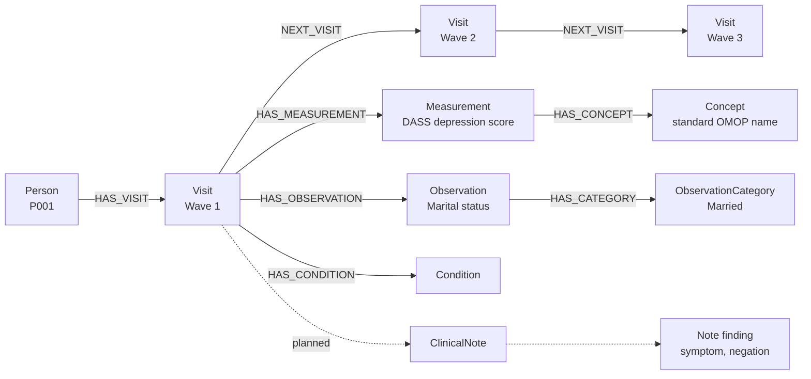
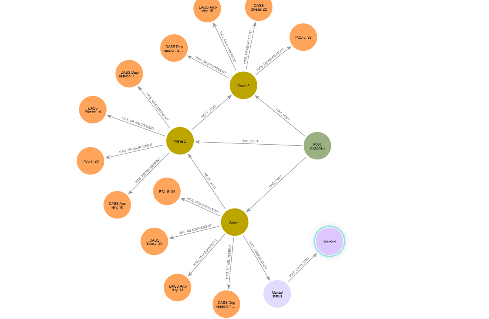
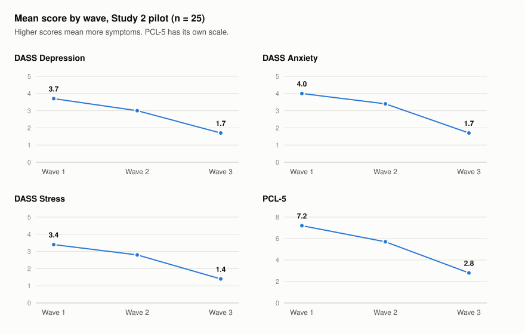
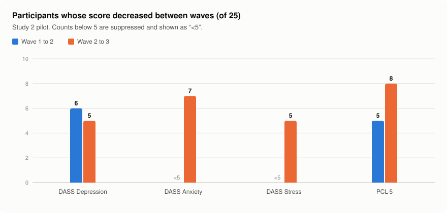
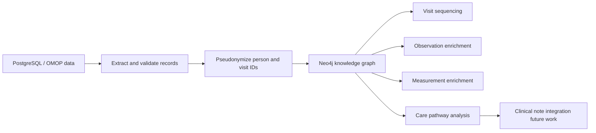

# FarajaMH OMOP Knowledge Graph

A longitudinal mental health knowledge graph that transforms OMOP-derived study data into a clinically meaningful patient journey in Neo4j.

---

## Executive summary

This project develops a longitudinal, person-centered knowledge graph for mental health data derived from OMOP-compliant study records. By linking the same patient across multiple visits and time points, the graph preserves continuity of care and connects observations, measurements, and conditions into a single clinical trajectory. The approach makes it possible to identify how symptoms, scores, and engagement change over time, and to detect where patients are lost to follow-up or disengage from services.

Unlike traditional relational data stores, which primarily represent records as isolated rows, this graph makes patient pathways visible as connected events. This is particularly important for mental health research and service delivery, where trajectories of wellbeing, functioning, and engagement evolve over time and are shaped by both clinical and social factors. The project therefore provides a more clinically interpretable and actionable model for understanding longitudinal care in mental health settings.

---

## Project abstract

This project develops a longitudinal, person-centered knowledge graph for mental health data derived from OMOP-compliant study records. By linking the same patient across multiple visits and time points, the graph preserves continuity of care and connects observations, measurements, and conditions into a single clinical trajectory. The approach makes it possible to identify how symptoms, scores, and engagement change over time and to detect where patients are lost to follow-up or disengage from services.

Unlike traditional relational databases, which primarily represent records as isolated rows, this graph makes patient pathways visible as connected events. This is particularly important for mental health research and service delivery, where trajectories of wellbeing, functioning, and engagement evolve over time and are shaped by clinical and social factors. The project therefore provides a more clinically interpretable and actionable model for understanding longitudinal care in mental health settings.

---

## Project summary

This project builds a longitudinal mental health knowledge graph from OMOP-based study data. The system links the same individual across multiple visits and time points, connecting observations, measurements, conditions, and future clinical-note findings into a continuous care pathway.

Rather than viewing patient data as disconnected rows in PostgreSQL, the project represents the same person as a connected clinical trajectory. This makes it possible to follow a patient from wave 1 to wave 2 to wave 3, identify changes in symptoms and scores over time, and pinpoint points where patients disengage from care.

---

## Why this matters

Mental health care is inherently longitudinal. Patients do not experience treatment as isolated records; they experience it as a sequence of encounters, assessments, symptom changes, and engagement patterns over time.

A traditional relational database can answer basic counts, but a knowledge graph can answer deeper care-path questions such as:

- Which patient followed the same trajectory from wave 1 to wave 2 to wave 3?
- Which symptoms worsened or improved over time?
- Which measurements changed across visits?
- Where did a patient stop attending care?
- Which observations and measurements are connected to a given care episode?

This makes the graph a stronger foundation for mental health pathway analysis, engagement monitoring, and longitudinal patient insight.

---

## The problem we are addressing

Healthcare and research teams often have rich clinical data, but it is difficult to see the full patient journey when evidence is spread across many tables and records.

The main challenges include:

- tracking the same patient across multiple visits and time points
- connecting measurements and observations to one person and one care episode
- understanding how symptoms and scores change over time
- identifying care gaps and drop-off between visits
- preparing for future integration of clinical notes and narrative risk indicators

The knowledge graph approach addresses these challenges by making relationships explicit and clinically interpretable.

---

## How the graph is built

The knowledge graph is constructed through an OMOP-to-Neo4j pipeline. Source records are first extracted from PostgreSQL, then person and visit identifiers are pseudonymized so the same individual can be followed across time while preserving privacy. The data are validated before being written to Neo4j to ensure that each measurement, observation, and visit matches the correct patient and encounter.

Each clinical entity is represented as a node in the graph, while relationships connect them into a longitudinal patient journey. For example, Person nodes are linked to Visit nodes through HAS_VISIT, visits to observations through HAS_OBSERVATION, visits to measurements through HAS_MEASUREMENT, and consecutive visits through NEXT_VISIT. This creates a connected care pathway rather than a set of isolated table rows.

### Graph model

The diagram shows the structure only; the values are illustrative, not participant data. Dashed links are planned.



The graph includes:

- Person nodes
- Visit nodes
- Observation nodes
- ObservationCategory nodes
- Measurement nodes
- Condition nodes
- Concept nodes
- Planned ClinicalNote and note-finding nodes (see [Known gap](#known-gap-clinical-notes))

Example relationships:

- Person -[:HAS_VISIT]-> Visit
- Visit -[:HAS_OBSERVATION]-> Observation
- Visit -[:HAS_MEASUREMENT]-> Measurement
- Visit -[:HAS_CONDITION]-> Condition
- Visit -[:NEXT_VISIT]-> Visit
- Observation -[:HAS_CATEGORY]-> ObservationCategory
- Measurement / Observation / Condition -[:HAS_CONCEPT]-> Concept

---

## Example patient journey

A single patient can be followed through a longitudinal care pathway:

- Wave 1: baseline assessment, observations, and measurements are recorded
- Wave 2: follow-up visit shows whether symptoms improved or worsened
- Wave 3: graph shows whether the patient remained engaged or dropped out of care

### Measurements recorded at each wave (standard OMOP names)

- Depression anxiety stress scales depression score
- Depression anxiety stress scales anxiety score
- Depression anxiety stress scales stress score
- PCL-5 post-traumatic stress disorder checklist for DSM-5

### Observations recorded at each wave

- Marital status
- Number in household
- Gravida
- Parity
- Birth outcome
- Delivery method

Observations link to their recorded category (for example `Marital status` → `Married`, `Parity` → `Parity 1`), and condition records are linked to the visit at which they were recorded.

This allows the system to represent not only isolated values, but a coherent patient trajectory over time.

### Current pilot status

The Study 2 pilot graph contains 25 participants, each followed across all three waves (75 visits), with 300 measurements, 450 observations and 34 condition records. Every count was checked against the PostgreSQL source after import. In Neo4j Browser each participant appears under a stable display ID (P001 to P025), each visit as Wave 1, Wave 2 or Wave 3 joined by `NEXT_VISIT`, and each measurement and observation under its real OMOP concept name with its recorded value.

Because every pilot participant has all three visits, the pilot demonstrates longitudinal tracking but not loss to follow-up. The full Study 2 dataset (775 participants, 2,325 visits) can be imported with the same script, subject to data-governance approval.

### One participant's pathway in Neo4j

The view below uses a **fictional** participant (P000) with invented scores, built with the same structure as the real graph. It shows how Neo4j Browser presents a participant: one person, three waves joined by `NEXT_VISIT`, each wave's named scores, and an observation linked to its recorded category.



### Pilot results: scores across the three waves

Aggregate results from the 25-participant pilot, produced by `cypher/06_figures.cypher` directly from the graph.

<picture>
  <source media="(prefers-color-scheme: dark)" srcset="figures/mean_scores_by_wave_dark.svg">
  
</picture>

| Measure | Wave 1 mean (SD) | Wave 2 mean (SD) | Wave 3 mean (SD) |
|---|---|---|---|
| DASS Depression | 3.7 (6.2) | 3.0 (5.4) | 1.7 (4.1) |
| DASS Anxiety | 4.0 (5.9) | 3.4 (5.0) | 1.7 (3.4) |
| DASS Stress | 3.4 (5.6) | 2.8 (5.0) | 1.4 (3.8) |
| PCL-5 | 7.2 (12.3) | 5.7 (10.0) | 2.8 (7.4) |

<picture>
  <source media="(prefers-color-scheme: dark)" srcset="figures/scores_decreased_dark.svg">
  
</picture>

| Measure | Decreased, wave 1 to 2 | Decreased, wave 2 to 3 |
|---|---|---|
| DASS Depression | 6 | 5 |
| DASS Anxiety | &lt;5 | 7 |
| DASS Stress | &lt;5 | 5 |
| PCL-5 | 5 | 8 |

Each participant's change is computed by following their own `NEXT_VISIT` link from one wave to the next. Average scores fell across all four measures. Most participants' scores were unchanged between waves, and standard deviations larger than the means suggest that symptoms are concentrated in a minority of participants. These are descriptive results from a small pilot: they are not a treatment effect and should not be generalized to the full Study 2 cohort. Counts below 5 are suppressed.

The example patient values elsewhere in this repository are illustrative. They should not be presented as results from a real participant unless they have been checked against the approved study data.

---

## Known gap: clinical notes

The OMOP schema for Study 2 includes the standard `note` and `note_nlp` tables, but both are currently empty, so the graph does not yet contain clinical-note information. This is the main gap to address next. The planned extension is:

- populate `note` / `note_nlp` from validated clinical documents through the Silver → Gold pipeline
- link each note to the participant and visit, and each extracted finding to a standard concept, recording whether the symptom was present or negated and the extraction method
- keep raw note text out of the graph; store only validated, coded findings with provenance

Until notes are available, a missing wave or missing score shows where follow-up data stops, not whether a person left care. Confirming care drop-off also needs referral, appointment or attendance records.

---

## Why the graph is stronger than pgAdmin tables

PostgreSQL and pgAdmin are excellent for structured storage and reporting. However, they do not naturally preserve the relational structure of a patient’s longitudinal experience.

A graph makes it easier to explore:

- the same person over time
- the connection between visits and outcomes
- the trajectory of symptoms and measurements across waves
- the point where a patient disengaged from care
- the broader clinical context behind each encounter

This makes the model especially valuable for mental health and longitudinal care research.

---

## Architecture overview



---

## Repository contents

| File | Purpose |
|---|---|
| `import_study2_graph.py` | Builds the graph from OMOP: people, waves, measurements, observations, categories, conditions and real concept names. Re-running it updates existing nodes instead of duplicating them. |
| `assign_display_ids.py` | Gives each participant a stable readable ID (P001, P002, ...) that never changes when more participants are added. |
| `graph_common.py` | Shared connection settings and the pseudonymization function. |
| `cypher/01_graph_validation.cypher` | Counts and integrity checks. |
| `cypher/02_participant_pathway.cypher` | Wave 1 → 2 → 3 for each participant, with real measurement and observation names. |
| `cypher/03_score_changes.cypher` | Score change across waves, for individuals and the cohort. |
| `cypher/04_care_engagement.cypher` | Engagement funnel and where follow-up data stops. |
| `cypher/05_pathway_view.cypher` | Clean single-participant view for Neo4j Browser. |
| `cypher/06_figures.cypher` | Aggregate queries behind the README charts, and a fictional participant for public screenshots. |
| `figures/` | README charts and `make_figures.py`, which redraws them from aggregate results. |
| `test_connections.py` | Checks PostgreSQL and Neo4j connectivity. |
| `test_graph_import.py` | Writes a small synthetic graph to test the Neo4j setup. |
| `enrich_*.py` | Original pilot enrichment scripts (fixed to the 25-participant pilot). `import_study2_graph.py` now performs all of these steps. |

## Running the pipeline

```bash
pip install -r requirements.txt

python test_connections.py
python import_study2_graph.py --dry-run          # counts and concept names only, no writes
python import_study2_graph.py --cohort existing  # rebuild the 25-participant pilot
python import_study2_graph.py --cohort all       # full Study 2
python assign_display_ids.py
```

Then run the files in `cypher/` in Neo4j Browser. Connection settings can be changed with the environment variables listed in `graph_common.py` (for example `FARAJAMH_CDM_SCHEMA`). Passwords and the pseudonymization secret are always prompted for and never stored.

### Privacy safeguards in the import

- Only pseudonymized IDs reach the graph; OMOP `person_id` and visit dates are never stored. Visits keep only their wave number and days since wave 1.
- Observation text is written only if it is a short categorical label (e.g. `Married`). Free text, phone numbers and ID numbers are rejected, and the category values are shown for review before anything is written.
- Query outputs and screenshots of real participants are participant-level data and should not be committed to this repository.

## The same question in pgAdmin and in the graph

*Which participants' scores rose between one wave and the next?*

In SQL this needs a window function to order each person's visits, then a self-join of the measurement table on person, concept and the next visit:

```sql
WITH v AS (
  SELECT person_id, visit_occurrence_id,
         ROW_NUMBER() OVER (PARTITION BY person_id ORDER BY visit_start_date) AS wave
  FROM study_2_cdm_r.visit_occurrence)
SELECT v1.person_id, m1.measurement_concept_id, v1.wave, m1.value_as_number, m2.value_as_number
FROM v v1
JOIN v v2 ON v2.person_id = v1.person_id AND v2.wave = v1.wave + 1
JOIN study_2_cdm_r.measurement m1 ON m1.visit_occurrence_id = v1.visit_occurrence_id
JOIN study_2_cdm_r.measurement m2 ON m2.visit_occurrence_id = v2.visit_occurrence_id
     AND m2.measurement_concept_id = m1.measurement_concept_id
WHERE m2.value_as_number > m1.value_as_number;
```

In the graph the visit order is stored once as `NEXT_VISIT`, so the query reads like the question:

```cypher
MATCH (p:Person)-[:HAS_VISIT]->(v1:Visit)-[:NEXT_VISIT]->(v2:Visit),
      (v1)-[:HAS_MEASUREMENT]->(m1)-[:HAS_CONCEPT]->(c:Concept),
      (v2)-[:HAS_MEASUREMENT]->(m2)-[:HAS_CONCEPT]->(c)
WHERE m2.value_as_number > m1.value_as_number
RETURN p.display_id, c.concept_name, v1.wave, m1.value_as_number, m2.value_as_number;
```

Both give the same answer. The difference is that the graph stores the pathway explicitly, so new links (conditions, clinical-note findings, referrals) can be added to a visit without redesigning the joins.

---

## Development roadmap

Future phases of the project include:

1. Stable longitudinal person tracking across all waves
2. Care-path analysis and drop-off detection
3. Expanded condition and symptom representation
4. Clinical note ingestion and NLP-based symptom extraction
5. Public-facing documentation and reproducible pipeline packaging

---

## Funders and stakeholders

This project demonstrates how OMOP-derived clinical data can be transformed into a clinically meaningful and interpretable knowledge graph. It is not only a data integration exercise; it is designed to support real-world questions about patient progression, symptom trajectories, continuity of care, and service disengagement.

For funders, the project shows both technical relevance and practical value. It offers a foundation for longitudinal mental health analysis, improved patient pathway understanding, and future clinical-note-informed decision support.

---

## Project status

The repository contains the core graph enrichment and validation scripts required to connect OMOP-derived data to Neo4j.

The next phase is to strengthen the public project narrative, document patient journeys clearly, and expand the graph toward clinical-note-informed care pathway analysis.

---

## Summary

This project creates a person-centered knowledge graph from OMOP mental health data, linking the same individuals across visits and time points and making their care pathways visible. By connecting observations, measurements, and future clinical note findings to the same patient journey, it offers a stronger and more clinically useful view of mental health care than static database tables alone.
